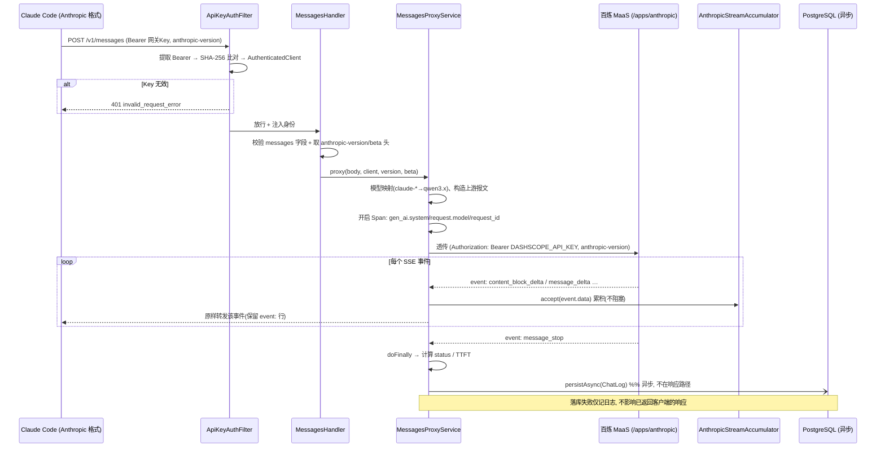

# AI 网关 · 架构说明

> 本文档遵循 `docs/onboarding/monorepo-directory-standard.md`，按其约定放在 `docs/architecture/`。
> 最后更新：2026-05-29

## 1. 这是什么

企业内部 **AI 网关**：对员工本地 **Claude Code** 等客户端暴露 **Anthropic Messages 接口**
（`POST /v1/messages`），将报文**透传**到 **阿里百炼 Token Plan MaaS（Anthropic 端点）**，
并在**不阻塞 SSE 流式转发**的前提下，**异步采集完整对话语料**（prompt + 最终回答 + token 用量），
用于后续微调企业专属"数字员工"。

> **协议定位：透传，非翻译。** 客户端（Claude Code）与上游（百炼 MaaS）**同讲 Anthropic 协议**，
> 网关只做：注入上游密钥、`claude→qwen` 模型名映射、透传 `anthropic-version`/`anthropic-beta` 头、旁路采集语料；
> 不解析/重写报文语义。最初的 OpenAI 兼容实现（`/v1/chat/completions`）已**休眠保留**以备回退（见第 3 节）。

核心诉求拆成三条，分别对应下文的设计：

1. **高并发流式代理** —— Spring WebFlux + WebClient，全链路非阻塞（第 4、5 节）。
2. **旁路语料采集** —— 流式"Tee"边转发边累积，结束后异步落库，绝不拖慢首字/吞吐（第 5 节）。
3. **可观测 + 可计费** —— OpenTelemetry(OTLP) 链路与指标 + 每日 Token 聚合（第 6、7 节）。

## 2. 在 Monorepo 标准中的位置

按 `monorepo-directory-standard.md`，本服务的**目标**归位如下；当前仓库仍是根级单模块，
**尚未物理重组**（见第 9 节「待验证 / 未完成」）：

| 标准目录 | 放什么 | 本服务对应物（目标路径） | 现状路径 |
|----------|--------|--------------------------|----------|
| `services/` | 后端服务代码 | `services/ai-gateway/` | 仓库根（`src/`, `pom.xml`） |
| `schemas/database/` | DB Schema / Migration | `schemas/database/ai-gateway/` | `src/main/resources/schema.sql` |
| `infra/docker/` | Docker 编排 | `infra/docker/ai-gateway/` | `docker-compose.yml`, `Dockerfile` |
| `.yunxiao/` | 云效流水线 | `hiot-service-dev.yml` / `-prod.yml` | 暂无 |
| `docs/architecture/` | 架构文档 | 本文件 | ✅ 已就位 |
| `docs/onboarding/` | 环境/接入 | `environment-guide.md` | ✅ 已就位 |

## 3. 组件总览

单模块 Spring Boot 应用，包 `com.company.aigateway`（★ = 当前 Anthropic 链路；其余 OpenAI 类休眠保留）：

| 包 / 类 | 职责 |
|---------|------|
| `web/ChatRouter` | 函数式路由：`/v1/messages`、`/v1/messages/count_tokens`、`/v1/chat/completions`(休眠) |
| ★ `web/MessagesHandler` | Anthropic 入口：取鉴权身份、校验 `messages`、透传 `anthropic-version`/`anthropic-beta` 头 |
| ★ `proxy/MessagesProxyService` | **代理核心**：claude→qwen 映射、上游报文构造、流式/非流式分支、落库编排、count_tokens 纯透传 |
| ★ `proxy/AnthropicStreamAccumulator` | **SSE 旁路累加器**：解析 Anthropic 事件，拼最终文本、归并 `tool_use`、抓 usage / TTFT |
| `proxy/RequestContext` | 单次请求可变上下文：计时、trace/span、错误状态 |
| `web/ChatHandler`、`proxy/ChatProxyService`、`proxy/StreamAccumulator` | OpenAI 兼容链路（**休眠保留**以备回退） |
| `security/ApiKeyAuthFilter` | WebFilter 鉴权（Bearer），放行 `/actuator`、`/health` |
| `security/ApiKeyService` | 用 **SHA-256** 比对网关下发 Key（支持可选 master-key 引导） |
| `token/TokenEstimator` | 上游缺 usage 时用 jtokkit（cl100k_base）兜底估算 |
| `persistence/CapturePersistenceService` | **异步落库**（fire-and-forget，跑 boundedElastic） |
| `persistence/entity/*`, `repository/*` | R2DBC 实体与仓库（PostgreSQL） |
| `config/*` | WebClient、DashScope/Gateway 配置属性、schema 初始化 |

技术栈：Spring Boot 3.3.5 / WebFlux / R2DBC（`org.postgresql:r2dbc-postgresql`）/ Micrometer Tracing + OTLP / jtokkit。

## 4. 核心业务流程（时序）



要点：

- **鉴权与上游密钥隔离**：客户端用"网关下发 Key"（库里只存 SHA-256），网关用 `DASHSCOPE_API_KEY`
  作为 `Bearer` 注入上游——员工拿不到真实百炼密钥。
- **模型映射**：`claude-3-5-sonnet→qwen3.7-max`、`claude-3-5-haiku→qwen3.6-flash` 等；以 `qwen` 开头者透传；其余落 `default-model`（`qwen3.7-max`）。
- **SSE 保真**：用 `bodyToFlux(ServerSentEvent<String>)` 转发，**保留 `event:` 行**（Anthropic 客户端依赖事件类型，不能像 OpenAI 版那样按裸字符串转发而丢掉事件名）。
- **`/v1/messages/count_tokens`**：纯透传量算端点，**不采集、不建 RequestContext**。
- **落库在响应之后、链路之外**：采集失败绝不影响客户端已收到的响应。

## 5. 流式旁路采集设计（Tee，关键）

目标：**即收即转**，同时拿到**完整 completion** 用于微调——两者不能互相拖累。

实现（`MessagesProxyService.streamingProxy` + `AnthropicStreamAccumulator`）：

```
upstream Flux<ServerSentEvent<String>>     // 保留 event: 行
   │
   ├─ doOnNext(event):                   // 旁路：同步但极轻量
   │     acc.recordFirstToken()          //   记录 TTFT（首帧）
   │     acc.accept(event.data())        //   解析 Anthropic 事件，拼最终文本 / tool_use / usage
   │
   ├─ map(event → ServerSentEvent)       // 主路：原样转发给客户端（保留 event/id/data）
   │
   └─ doFinally(signal):                 // 流结束（正常/取消/异常）
         status = ERROR | PARTIAL | SUCCESS
         记录 TTFT 指标
         capture(...) → persistenceService.persistAsync(...)   // 异步落库
```

`AnthropicStreamAccumulator.accept(payload)` 按事件 `type` 分派：

- `message_start` → 取 `message.id` / `message.model` / `usage.input_tokens`（初值）。
- `content_block_start` → 记 `tool_use` 块的 id/name。
- `content_block_delta` → `text_delta` 追加到最终回答；`input_json_delta` 累积工具参数；
  **`thinking_delta` / `signature_delta` 忽略**（推理内容不入库）。
- `message_delta` → 取 `stop_reason` 与 `usage.output_tokens`；并用其**复报的 `input_tokens` 覆盖**
  `message_start` 初值（上游在此处口径更全，含 system/cache，避免少计）。

设计取舍：

- **不阻塞**：累积是纯内存、单订阅内顺序执行（无并发），不做 I/O；真正的 DB 写在 `doFinally`
  之后通过 `Schedulers.boundedElastic()` 异步完成，**不占 EventLoop**。
- **断连仍有价值**：`doFinally` 的 `SignalType.name()` 为 `CANCEL`/`ON_ERROR` 时落 `PARTIAL`
  状态——客户端中途断开，已拼接的部分语料仍保留。
- **token 取上游**：Anthropic SSE 末帧本就带 `usage`，直接采信（`token_source=UPSTREAM`）；
  极端缺失时由 `TokenEstimator` 兜底（见第 7 节）。
- **采集口径**：`completion_content` 仅存**最终文本**；`tool_use` 以 Anthropic 原生结构存入 `tool_calls`；
  thinking/推理块不持久化。
- **截断保护**：`completion` 超过 `gateway.capture.max-completion-chars`（默认 1,000,000）
  追加 `...[TRUNCATED]`，防止异常长输出撑爆内存/列。
- **非流式路径**：`exchangeToMono` 整体拿到响应后透传，遍历 `content` 数组取 `text`/`tool_use`，一次性 `capture(...)`。

## 6. 可观测性（OTLP）策略

桥接 **Micrometer Tracing → OpenTelemetry**，trace 与 metric 均经 **OTLP** 上报到
`otel-collector`（compose 内置，gRPC 4317 / HTTP 4318）。遵循 **GenAI 语义约定**：

| 维度 | 名称 | 来源 |
|------|------|------|
| Trace 属性 | `gen_ai.system=dashscope`、`gen_ai.request.model`、`gateway.request_id` | `MessagesProxyService.tagSpan` |
| 指标(计数) | `gen_ai.client.token.usage`（`gen_ai.token.type=input/output`） | `recordTokenMetrics` |
| 指标(计时) | `gen_ai.server.time_to_first_token` | 流式 TTFT |
| 关联 | `chat_log.trace_id` / `span_id` 回写库 | 日志↔链路互查 |

配置见 `application.yml` 的 `management.otlp.*` 与 `management.tracing.sampling`；
Actuator 暴露 `health,info,metrics,prometheus`。

**导出默认关闭（本地）**：`OTEL_SAMPLING` 默认 `0.0`（不采样即不导出 span，但**保留 Tracer Bean**避免下游注入失败），
`OTLP_METRICS_EXPORT` 默认 `false`（不每 10s 推 metric）。这是为本地裸跑无 collector 时**不刷屏**，并非隐藏故障——
语料采集与 OTLP **互相独立**，落库照常。docker-compose 内置 collector，置 `OTEL_SAMPLING=1.0` / `OTLP_METRICS_EXPORT=true` 全量导出。

## 7. Token 计量

`MessagesProxyService.capture` 选择来源：

- **UPSTREAM**：上游返回了 `usage`（流式末帧或非流式响应体）→ 直接采信，`token_source=UPSTREAM`。
- **ESTIMATED**：上游缺 `usage` → `TokenEstimator`（jtokkit `cl100k_base` BPE）对 messages 与
  completion 估算，`token_source=ESTIMATED`。

每行写入 `chat_log`，同时 upsert 到 `token_usage_daily`（按 `日期 × client × 模型` 聚合），
供报表/计费。聚合用 PostgreSQL `INSERT ... ON CONFLICT ... DO UPDATE`（见 `CapturePersistenceService`）。

## 8. 数据模型（PostgreSQL DDL）

数据库为 **PostgreSQL**，部署在**专用实例的 `ai-gateway` 库**（不与既有业务库共用）。关键类型：
`UUID` 请求标识、`JSONB` 存语料、`TIMESTAMPTZ` 时间、`GENERATED ALWAYS AS IDENTITY` 自增、
对异常状态的**部分索引**。完整脚本见 `src/main/resources/schema.sql`：

```sql
-- 表1：客户端/员工身份（网关 Key 仅存 SHA-256）
CREATE TABLE IF NOT EXISTS api_client (
    id              BIGINT GENERATED ALWAYS AS IDENTITY PRIMARY KEY,
    client_key_id   VARCHAR(64)  NOT NULL UNIQUE,
    api_key_hash    VARCHAR(128) NOT NULL,
    employee_id     VARCHAR(64),
    display_name    VARCHAR(128),
    enabled         BOOLEAN      NOT NULL DEFAULT TRUE,
    rate_limit_qps  INT,
    created_at      TIMESTAMPTZ  NOT NULL DEFAULT now()
);

-- 表2：会话主日志（微调语料核心）
CREATE TABLE IF NOT EXISTS chat_log (
    id                    BIGINT GENERATED ALWAYS AS IDENTITY PRIMARY KEY,
    request_id            UUID         NOT NULL UNIQUE,
    upstream_request_id   VARCHAR(64),
    trace_id              VARCHAR(32),
    span_id               VARCHAR(16),
    client_id             BIGINT,
    employee_id           VARCHAR(64),
    model_requested       VARCHAR(64)  NOT NULL,
    model_upstream        VARCHAR(64)  NOT NULL,
    is_stream             BOOLEAN      NOT NULL,
    request_messages      JSONB        NOT NULL,
    request_params        JSONB,
    completion_content    TEXT,
    completion_role       VARCHAR(16)  DEFAULT 'assistant',
    tool_calls            JSONB,
    finish_reason         VARCHAR(32),
    prompt_tokens_est     INT,
    completion_tokens_est INT,
    total_tokens_est      INT,
    token_source          VARCHAR(16)  NOT NULL DEFAULT 'ESTIMATED',
    status                VARCHAR(16)  NOT NULL,
    http_status           INT,
    error_type            VARCHAR(64),
    error_message         TEXT,
    ttft_ms               INT,
    duration_ms           INT          NOT NULL,
    created_at            TIMESTAMPTZ  NOT NULL DEFAULT now(),
    finished_at           TIMESTAMPTZ
);

CREATE INDEX IF NOT EXISTS idx_chatlog_client_time ON chat_log (client_id, created_at DESC);
CREATE INDEX IF NOT EXISTS idx_chatlog_time        ON chat_log (created_at DESC);
CREATE INDEX IF NOT EXISTS idx_chatlog_model_time  ON chat_log (model_upstream, created_at DESC);
CREATE INDEX IF NOT EXISTS idx_chatlog_abnormal    ON chat_log (status) WHERE status <> 'SUCCESS';

-- 表3：每日 Token 用量聚合
CREATE TABLE IF NOT EXISTS token_usage_daily (
    stat_date          DATE         NOT NULL,
    client_id          BIGINT       NOT NULL,
    model_upstream     VARCHAR(64)  NOT NULL,
    request_count      BIGINT       NOT NULL DEFAULT 0,
    prompt_tokens      BIGINT       NOT NULL DEFAULT 0,
    completion_tokens  BIGINT       NOT NULL DEFAULT 0,
    total_tokens       BIGINT       NOT NULL DEFAULT 0,
    PRIMARY KEY (stat_date, client_id, model_upstream)
);
```

> JSONB 列在实体里映射为 `io.r2dbc.postgresql.codec.Json`。当前语料 JSON 仅"整存整取"
> （按标量列查询、整段导出做微调），未用到 JSONB 的深查能力；保留 JSONB 是为将来可直接用
> `@>` / jsonpath 做结构化分析，以及配合 **pgvector** 做语义检索 / RAG 留出空间。

## 9. 现状与演进

> 记录「Anthropic 透传改造 + 运行验证」之后的状态，供后续 Session 参考。

**已确认 / 已完成**

- **协议 = Anthropic 透传**（本轮落地）：上游端点确认为百炼 Token Plan MaaS
  `https://token-plan.cn-beijing.maas.aliyuncs.com/apps/anthropic/v1/messages`，client 与上游同讲 Anthropic 协议，
  网关不做协议翻译。新增 `MessagesHandler` / `MessagesProxyService` / `AnthropicStreamAccumulator` 三个类；
  OpenAI 兼容链路休眠保留。**原「上游端点口径不一致」风险已消除。**
- **端到端跑通**：Claude Code 经网关完成真实 agentic 任务（含 `tool_use`），流式 SSE 保真转发，
  语料按 SUCCESS / PARTIAL 正确落库（最终文本入 `completion_content`，thinking 不入库，token 取上游 UPSTREAM）。
- **鉴权 bug 修复**：`ApiKeyAuthFilter` 原把 `switchIfEmpty` 挂在 `chain.filter()`（返回 `Mono<Void>`，
  正常完成即"空"）之后，导致每个请求都误判未鉴权、在响应已提交后再写头抛 `UnsupportedOperationException`
  中断流。已改为把 `switchIfEmpty` 挂在 `authenticate(token)` 上。
- **DB 选型 = PostgreSQL**（外部实例，如阿里云 RDS）：专用库不与既有业务库共用，为 pgvector 预留空间。
- **编译与依赖**：`mvn -DskipTests package` 通过，`org.postgresql:r2dbc-postgresql` 在列，无 mysql 依赖。

**待办 / 注意**

1. **Schema 自动初始化策略**：`ConnectionFactoryInitializer` 每次启动跑 `schema.sql`（幂等）；
   生产建议改 **Flyway/Liquibase** 管理并按需关闭自动执行。
2. **仓库尚未按 Monorepo 标准重组**：当前为根级单模块，目标是迁入 `services/ai-gateway/`，
   DDL 入 `schemas/database/`，编排入 `infra/docker/`，流水线入 `.yunxiao/`（见第 2 节）。
3. **可观测性后端未落地**：本地默认不导出 OTLP（无 collector）；如需监控，部署侧需提供 collector/后端
   并开启 `OTEL_SAMPLING` / `OTLP_METRICS_EXPORT`。
4. **密钥治理**：`.env.example` 含明文密钥（历史遗留），建议迁移密钥管理（KMS / 云效变量 / K8s Secret）并轮换。
5. **OpenAI 兼容链路**为休眠代码，若长期不回退可考虑后续清理。
